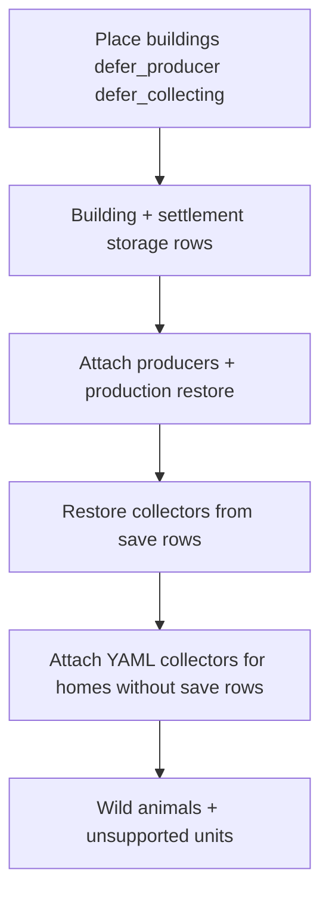

# Legacy SQLite — collector rows

## How Godot spawns collectors (normal build)

1. `BuildingFactory.create_building()` attaches components from exported YAML.
2. `CollectingComponent` reads collector **unit type ids + counts** from the building export and calls `CollectorRegistry.create_collector()` immediately.
3. Collectors are **not** world-positioned units; they are sim objects tied to the home building.

## What legacy saves store

| Table | Relevant columns |
|-------|------------------|
| `unit` | `rowid`, `type`, `x`, `y`, `owner` |
| `building_collector` | `rowid` (= unit worldid), `home_building`, `creation_tick` |

Saved collectors have map positions and scheduler history Godot does not model yet.

## SQLite import order (desktop)

1. **Place buildings** with `defer_producer` and `defer_collecting` (no YAML collectors yet).
2. **Storage** — building inventories + **`settlement` rowid** rows → `session.settlement.inventory` ([`sqlite_extract_settlement.py`](../../development/godot/sqlite_extract_settlement.py)).
3. **Producers** — attach without auto-start, then [`sqlite_extract_production.py`](../../development/godot/sqlite_extract_production.py).
4. **Collectors** — [`sqlite_extract_units.py`](../../development/godot/sqlite_extract_units.py) rows with `kind: collector`:
   - **Save wins:** one sim collector per save row (`unit_type_id`), via `CollectingComponent.attach_from_save_rows`.
   - Homes with **no** save rows but YAML `Collecting` get YAML spawn in `_attach_deferred_yaml_collecting`.
5. **Other units** — wild animals spawned; ships/settlers/generic units → `unsupported_unit_rows` (not collector metrics).

Building rows use **`trust_legacy_placement`** so saved coordinates are not rejected by live buildability rules ([`BuildCommand`](../../scripts/sim/commands/build_command.gd)).

## Import policy

| Case | Behaviour |
|------|-----------|
| Save has collector rows for home building | Restore **N** collectors from save (types from `unit.type`); **do not** YAML-auto-spawn first |
| Save has no rows, YAML has `Collecting` | YAML counts after collector pass |
| Save rows but building has no `Collecting` in export | `collectors_unsupported_no_collecting_yaml` |
| Home building not placed | Rows → `collectors_unsupported` |

**Not restored (diagnostics only):** `unit_path`, `collector_job`, `building_collector_job_history` — row counts via [`sqlite_extract_collector_jobs.py`](../../development/godot/sqlite_extract_collector_jobs.py) → report `collector_job_rows_in_save`. Saved collector worldids still not re-keyed in sim (phase 2).

## Report fields

- `collectors_restored`, `collectors_save_homes`, `collector_rows_in_save`
- `collectors_unsupported`, `collectors_unsupported_no_collecting_yaml`
- `collectors_skipped_yaml_duplicate` (should stay **0** when defer_collecting works)
- `unsupported_unit_rows` (ships, settlers, generic `unit` rows)
- `settlement_storage_rows_applied`, `legacy_settlement_worldid`, `legacy_island_worldid`

Imports remain **`partial: true`** while `unsupported_unit_rows > 0`, storage/production rows are skipped, or buildings are truncated.

## Prerequisites for full collector fidelity

- Production / scheduler tick restore — **done (subset):** `Production.restore_from_legacy_save`
- Collector job state machine parity with legacy `BuildingCollector`
- Settlement ownership and multi-island `location` column handling
