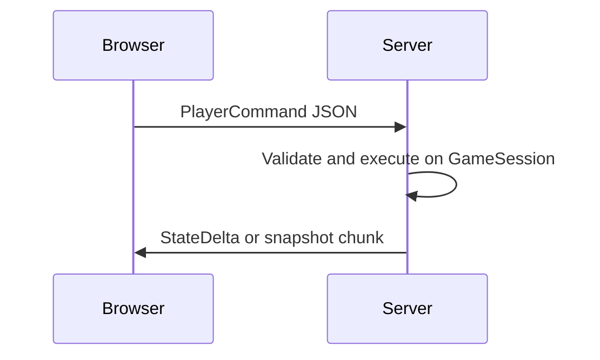

# Unknown Horizons Godot Port — Project Roadmap

Last verified: **2026-10-17** — `./godot/run_tests.sh` **154/154** GUT pass; parity golden **4/4** (`wood`, `warehouse_collector`, `farm_crop`, `snapshot_roundtrip`).

## Vision

Players eventually load the game from a URL (static hosting, no install). The **simulation** owns truth (settlements, inventories, production, commands, time). The **presentation** renders and sends commands; it must not invent resources or buildings.

Long-term the game may be rebranded (art, copy, buildings, factions, individuals). Stable **simulation identifiers** stay separate from display names and content packs.

## Core rule: UI → commands only

| Layer | Owns |
|-------|------|
| `scripts/sim/` | World state, rules, ticks, save snapshots |
| `scripts/view/` | Map, HUD, input, sprites, audio |

Presentation may call `CommandManager.execute(...)`, read sim state, and listen to `MessageBus`. It must not call `inventory.alter` on authoritative sim state except in dev-only debug tools.

## Audit summary (Phase Zero)

### Playable today

- **Headless sim:** `GameSession`, production, collectors, buildability, JSON snapshot v3, 28/28 building integration waves.
- **PoC scene:** `scenes/poc_main.tscn` — test map, build palette, placement via `BuildCommand`, sim clock, HUD, save/load.
- **Not playable:** Full UH campaign, ship/found-settlement, legacy GUI suite (~30 pytest modules deferred).

### Ported vs partial vs missing

| Genuinely ported | Partial / stub | Missing / XL |
|------------------|----------------|--------------|
| Scheduler, storage, production, commands | SQLite subset via `OS.execute` (desktop only) | Real map DB load |
| JSON save v3 + tests | 5-building gfx slice + placeholders | MP / server |
| Parity harness + golden traces | Minimal HUD | Full GUI parity |

### Headless sim

Yes — GUT and `parity_runner.tscn` run without the main visual scene.

### Save/load

| Path | Status |
|------|--------|
| JSON `user://poc_snapshot.json` + file export/import | PoC + tests |
| Legacy `.sqlite` | Subset building replay (desktop) |
| Browser | `user://` (IndexedDB) + download/upload JSON |

### Content reuse

YAML under `legacy/content/` → `development/godot/export_content.py` → `resources/exported/` + `game_constants.gd`. Gfx via `export_gfx.py` and `BuildingVisualRegistry`. Optional DLC pack `resources/dlc/northern_company/`.

### Web export

Reproducible via `./godot/export_web.sh` → `build/web/`. See [WEB_DEPLOYMENT.md](WEB_DEPLOYMENT.md).

### Parity confidence

154 GUT tests; 4 parity scenarios vs golden traces (legacy Python optional when `fife` is installed).

### Architectural risks

1. Web vs desktop API gaps (`OS.execute`, SQLite import).
2. Sim tick must stay independent of frame rate (`SimClock`).
3. Export bundle size (full `buildings.json`; trim later if needed).
4. Accidental UI shortcuts bypassing commands.

## Milestones

| ID | Goal | Exit criteria |
|----|------|----------------|
| **M0** | Roadmap + README accuracy | This doc; README matches PoC controls |
| **M1** | Browser build | `export_web.sh`, preset, WEB_DEPLOYMENT, smoke checklist |
| **M2** | Economic loop | Lumberjack + trees → boards; save round-trip; integration test; browser saves |
| **M3** | Sim/view boundaries | No prod `alter` in view; `SimClock`; rules documented |
| **M4** | Data-driven + theme | `validate_content.py` in sync/CI; theme pack demo |
| **M5** | Save integrity | SAVE_FORMAT.md, migration hook, `snapshot_roundtrip` parity |
| **M6** | Living world (design) | Sections below — no large implementation |
| **M7** | Cross-version saves & play (future gate) | See **Future ideas** — required before treating Godot as the primary client |

## Future ideas

These are intentional next horizons—not current milestones—but they should **gate** a full cutover from the Python/FIFE game to Godot. The port is not “complete” until players can move between engines without losing progress, and (ideally) play together across engines.

### Legacy save fidelity (Python → Godot)

- **Goal:** Open real **original-game savegames** (`.sqlite` / legacy format) in Godot and continue playing with the same settlement state that matters for gameplay (map, buildings, inventories, production state, settlers/units as they are ported).
- **Today:** Subset load only — buildings via `SqliteSaveLoader` + `sqlite_extract_buildings.py` on desktop; not web-safe.
- **Tests to add:** A growing **fixture library** of authentic saves (small → large); for each fixture, assert key invariants after load (building counts, resource totals, tick/time, selected world ids). Failures mean the Godot sim is still missing rules or export mappings.
- **Smooth transition:** Document a player workflow: *save in Python → copy file → load in Godot* (and later the reverse once Godot can write compatible saves or an documented interchange format exists).

### Cross-version play (Python + Godot in one world)

- **Goal:** Before moving on to unrelated big features, prove **mixed clients**: one player on the **legacy Python** build and another on the **Godot** build in the **same** session or shared world (observe the same sim truth, submit compatible commands).
- **Why it matters:** Forces agreement on commands, ticks, entity ids, and network/state sync—not just single-player parity traces.
- **Likely shape:** Aligns with [Future server direction](#future-server-direction-design-only)—authoritative sim, versioned command envelope, clients are thin. Mixed-engine play is an **acceptance test** for that design, not a one-off hack.
- **Pragmatic staging:**
  1. Same save loads in both engines; manual QA on identical scenario steps (dual-run parity extended to full saves).
  2. Hot-join or sync via a small relay/server (out of scope until single-player legacy load is trustworthy).
  3. Only then: declare Godot ready to replace Python for multiplayer scenarios.

### Exit criteria (proposal — do not skip)

| Criterion | Meaning |
|-----------|---------|
| Fixture saves load in Godot | No silent data loss; explicit errors for unsupported fields |
| Python → Godot → play | Player can continue a campaign slice without debug cheats |
| Parity on loaded state | After load, run N ticks; compare traces or inventories vs golden |
| Cross-version session (stretch) | Python + Godot clients stay in sync on a test map |
| Reverse path (stretch) | Godot save or export readable by Python, or documented migration only |

See also [MIGRATION_STRATEGY.md](MIGRATION_STRATEGY.md).

## Browser blockers (living list)

| Blocker | Status |
|---------|--------|
| No export preset / script | **Resolved** — M1 |
| Forward+ without Compatibility on web | **Resolved** — web preset uses Compatibility |
| SQLite `OS.execute` on WASM | **Resolved** — gated on `OS.has_feature("web")` |
| Ephemeral saves only | **Mitigated** — download/upload JSON in PoC |
| No automated browser CI | **Open** — manual smoke in WEB_DEPLOYMENT |
| Full game content size | **Open** — monitor PCK size |

## M2 — Economic loop (assessment)

**Target loop:** map → palette → place lumberjack → place trees → clock runs → collector/production → boards in storage → HUD updates → save → reload.

**Legitimate path:** `BuildCommand` for lumberjack and `TREE`; production/collector sim (see `test_lumberjack` in `test_buildings_wave_f1.gd`).

**Remaining polish:** onboarding hint in HUD; dev-only resource debug panel.

## M5 — Determinism notes

- Parity scenarios use **ticks** / `run_seconds` (16 ticks/s), not wall clock in sim.
- Sources of nondeterminism: RNG (when used), hash iteration order, `finish_production_now()` in tests only.
- Cross-platform deterministic replay is **not** claimed until measured.

## M6 — Living world (future design)

### Individuals (future `scripts/sim/agents/`)

- Needs, skills, home/workplace, schedules, relationships.
- Decision logic: explicit state machines + unit tests; **no LLM in core sim**.

### Economy (extend existing storage/production)

- Supply/demand, shortages, trade routes, labour allocation on top of `Inventory` / collectors.

### Factions (future)

- Settlement identity, diplomacy, territory — command-validated, snapshot-serializable.

### Performance

- Tick scheduling (`GameScheduler`), event-driven updates, coarser sim for distant settlements when needed.
- No multithreaded sim or distributed workers in near term.

## Future server direction (design only)

- Server owns authoritative `GameSession`; clients render and submit commands (same shape as `CommandManager`).
- Persistent worlds and multi-client observe later; **no** auth/DB/MP in current milestones.
- First browser build stays **single-player**, static hosting.

## Related docs

- [WEB_DEPLOYMENT.md](WEB_DEPLOYMENT.md)
- [SAVE_FORMAT.md](SAVE_FORMAT.md)
- [SCAFFOLDING.md](SCAFFOLDING.md)
- [PORT_CHECKLIST.md](../PORT_CHECKLIST.md)
- [development/godot/parity/README.md](../../development/godot/parity/README.md)

## Stable identifiers vs display names

- Simulation uses numeric IDs from `GameConstants` (e.g. `BUILDINGS.LUMBERJACK`) and export **stems** (`lumberjackcamp`).
- YAML `id` / `id_name` map to those constants at export time.
- Player-visible names live in content packs / UI JSON (`ContentTheme`), never as sim dictionary keys.

## Theme / reskin workflow

1. Set `resources/exported/active_theme.json` → `{ "pack_id": "northern_company" }` (or empty for default).
2. Reload PoC — palette labels and building tints use pack metadata (sim rules unchanged).
3. See `resources/dlc/northern_company/` for the reference pack.
